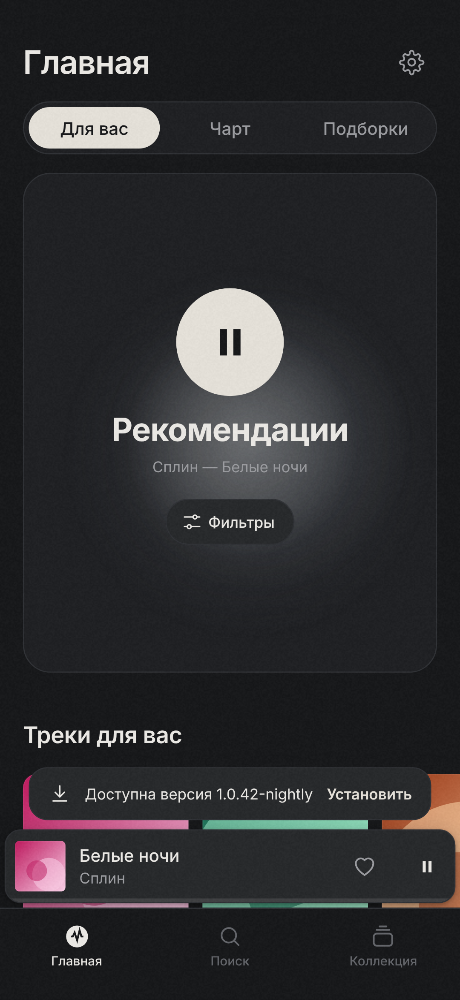
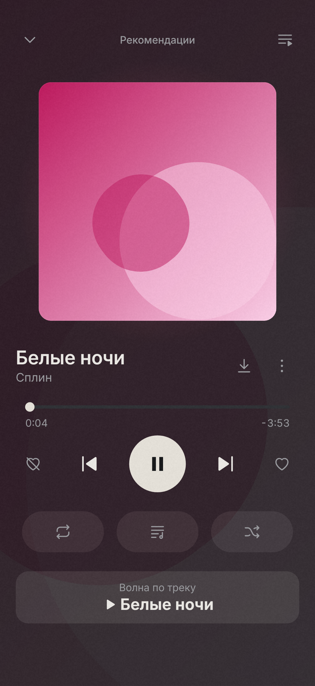
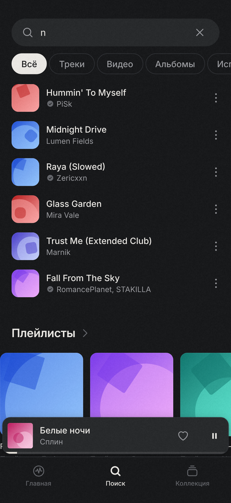
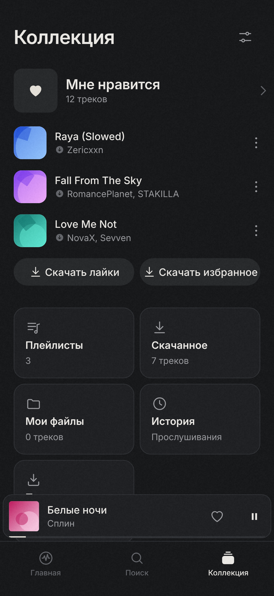
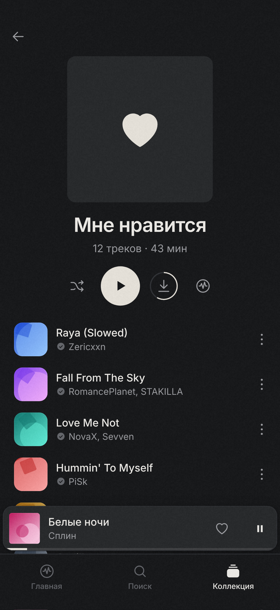
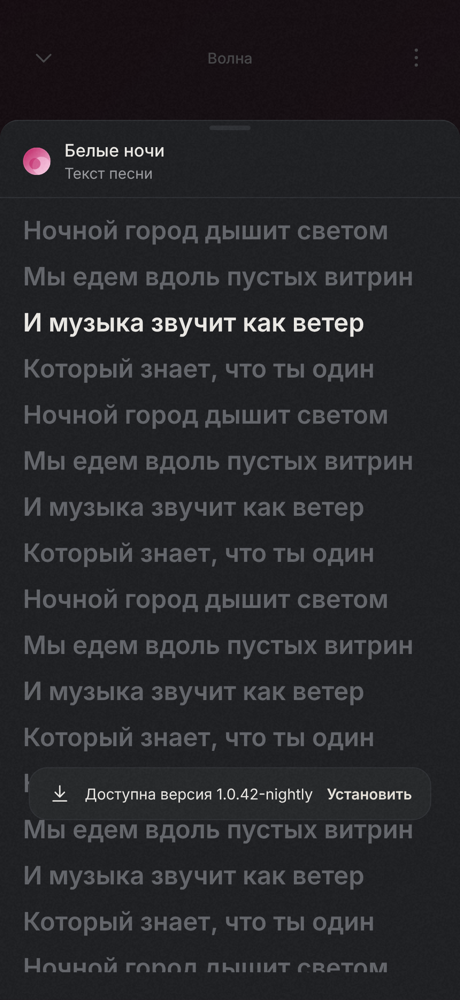
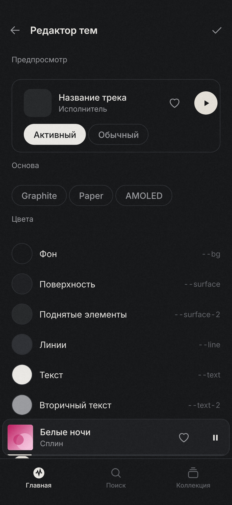
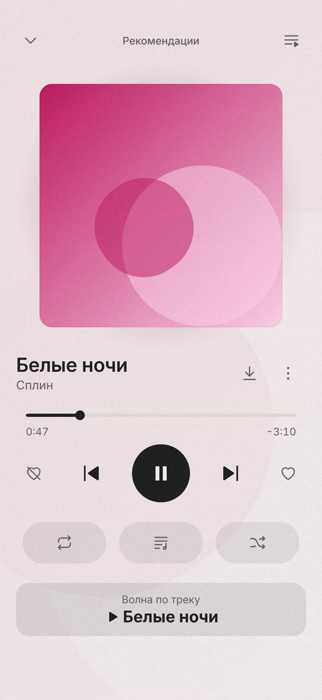

# You Music

**Музыка с YouTube без рекламы — с рекомендациями под ваш вкус, текстами, офлайном и переносом из Spotify, Яндекс Музыки и Telegram.**

Плеер для Android, браузера ([веб-плеер](https://grzxk.ru/youmusic/app/)), Windows и Linux: поиск и воспроизведение без ключей и аккаунта, бесконечные рекомендации с фильтрами, лайки и плейлисты, офлайн-загрузки, свои файлы, темы и моды. Сайт: [grzxk.ru/youmusic](https://grzxk.ru/youmusic/).

Дизайн-система **Graphite**: нейтральный графитовый интерфейс, цвет приносят только обложки.

<p>




</p>
<p>




</p>

> Скриншоты сняты с веб-интерфейса на тестовых данных (обложки — сгенерированные абстракции). Все экраны: [docs/screenshots](docs/screenshots).

## Установка

1. Откройте **[Releases](../../releases)** → `nightly` (последняя сборка) или версию `v*`.
2. Скачайте `you-music-*.apk` и установите (разрешите установку из неизвестных источников).

**Веб-плеер:** [grzxk.ru/youmusic/app](https://grzxk.ru/youmusic/app/) — без установки. Библиотека хранится в браузере; войдите в аккаунт, чтобы синхронизировать её с телефоном.

**Windows / Linux:** в том же релизе `nightly` — `YouMusic-windows.exe` и `YouMusic-linux.tar.gz` (распакуйте и запустите `./YouMusic`). Это тот же интерфейс в окне pywebview с локальным бэкендом на Python (yt-dlp); работают скачивание и прокси.

Только для личного использования. Аналитики и трекинга нет.

## Возможности

* **Главная** — «Для вас»: бесконечные «Рекомендации» и подборка; режим (Микс / Любимое / Открытия) — кнопкой фильтра. Фильтры сочетаются: «Популярное», «Новинки», «Русское», «Иностранное», «Без слов», «Энергичное», «Спокойное» и свои словами («для бега», «80-е» — их понимает нейросеть; удалить — долгое нажатие). При смене фильтров играющий поток сразу пересобирает оставшуюся очередь. «Продолжить волну» — прошлые потоки с того места, где остановились; «Чарт» (Яндекс Музыка), «Похоже на…», недавно прослушанное.
* **Рекомендации** — гибрид: похожие треки по вашим лайкам и истории, оценка по вайбу (темп, энергия), **эпохе** (если вы слушаете свежую музыку, старьё не подсовывается) и фильтрам, плюс подсказки нейросети, которая знает текущий год и тренды. «Не нравится» (перечёркнутое сердце) убирает трек и приглушает исполнителя. В настройках — «Быстрее» или «Тщательнее» (больше кандидатов и сильная модель). Поток по плейлисту — кнопка волны на странице плейлиста.
* **Волна по треку** — меню трека или «Похожие» в плеере: поток похожих по звучанию и настроению. Для рекомендаций используются базовые данные треков из открытого API Deezer (темп, громкость, жанры → энергия и агрессивность); в интерфейсе эти числа не показываются.
* **Поиск** — подсказки, история, фильтры (всё, треки, видео, альбомы, исполнители, плейлисты). Названия приводятся к виду «исполнитель — название», мусор вроде *(Official Video)*, *lyrics*, *HD* вырезается; официальное аудио и Topic-каналы — выше, длинные клипы — ниже.
* **Коллекция** — «Мне нравится», плейлисты (создание, переименование, порядок перетаскиванием), скачанное, мои файлы, история, любимые исполнители, вкладки модов.
* **Плеер** — фон, уведомление, экран блокировки, гарнитура (Media3). Полноэкранный плеер с перелётом обложки, свайпами, динамическим цветом, очередью и похожими. Синхронная строка текста поверх обложки, полный текст с переводом на русский одной кнопкой. «О треке» — источник, кодек, битрейт, частота, размер. Каждый исполнитель (в том числе feat.) — отдельная ссылка. Обложки следующих треков грузятся заранее.
* **Офлайн** — загрузки треков и плейлистов (очередь, прогресс, качество, только Wi-Fi), кэш с лимитом, работа без сети на скачанном и своих файлах.
* **Свои файлы** — импорт отдельных файлов или целой папки.
* **Темы** — Graphite, Paper, AMOLED, Liquid Glass (настоящее стекло: размытые полупрозрачные панели), Catppuccin Mocha, Nord, Synthwave и свои: редактор с живым предпросмотром, импорт/экспорт JSON.
* **Иконка приложения** — 20 вариантов (светлые и тёмные) в «Настройки → Иконка приложения»; переключаются через `activity-alias`, лаунчеру нужна пара секунд.
* **Первый запуск** — выбор темы, инструкция по переносу музыки (Spotify, Яндекс Музыка, список/CSV) и предложение необязательного аккаунта.
* **Аккаунт You Music (необязательно)** — только логин и пароль: облачная синхронизация лайков, плейлистов и истории между устройствами, нейросеть в рекомендациях без своей настройки (50 запросов в день), бесплатный прокси и перенос из Telegram. Своя нейросеть и свой прокси, если включены, имеют приоритет над серверными. Сервер — `server/` (Node 22 без зависимостей), ключи нейросети хранятся только на сервере.
* **Недоступные видео** — если YouTube отвечает «This video is not available», плеер сам находит другую загрузку того же трека.
* **Исполнитель кликабелен** — в открытом плеере и списках (в мини-плеере нажатие открывает плеер) имя ведёт на страницу исполнителя.
* **Моды** — zip/папка с `manifest.json`: кнопки в плеере, пункты меню, вкладки, экраны настроек, CSS, наборы иконок, хуки поиска/очереди/рекомендаций. См. [docs/mods.md](docs/mods.md).
* **Перенос из Spotify и Яндекс Музыки** — по ссылке на публичный плейлист/альбом (или «Мне нравится» публичного профиля Яндекса), списком «Исполнитель — Название» или CSV (например, Exportify). Каждый трек подбирается на YouTube, результат — новый плейлист или лайки. Коллекция → «Перенос музыки». Если Яндекс отвечает 451 или капчей (зарубежный IP, VPN), запрос сам уходит через бесплатные публичные прокси из России: списки берутся из открытых агрегаторов, десятки адресов проверяются параллельно, побеждает первый ответивший. Через них идёт только перенос.
* **Резервная копия** — «Экспорт всего» / «Импорт всего» (лайки, плейлисты, история, настройки, темы, состояние модов, прокси; ключ нейросети в файл не попадает) и **автокопия** в выбранную папку: файл `you-music-backup.json` обновляется после каждого изменения и перед установкой обновления и переживает удаление приложения. После переустановки приложение само предложит восстановить данные. Также включён системный бэкап Android (база и настройки).
* **Скачать лайки / избранное** — одной кнопкой в коллекции и на экране «Офлайн».
* **Своя нейросеть** — любой OpenAI-совместимый API (модель, адрес, ключ в Настройки → Своя нейросеть или ссылкой `youmusic://ai?base=…&model=…&key=…`): помогает всем режимам рекомендаций и понимает свои фильтры.
* **Перенос из Telegram** — «Перенос музыки → Музыка из Telegram»: привяжите бота [@Youmusikks_bot](https://t.me/Youmusikks_bot) к аккаунту и пересылайте ему аудиофайлы (до 20 МБ). Трек, найденный на YouTube, играет оттуда; остальные скачиваются на телефон с сервера. Обложка: из Telegram → найденного трека → сгенерированная.
* **Поделиться** — ссылка `https://grzxk.ru/youmusic/t/<id>`: открывает трек в приложении (или предлагает скачать его / открыть на YouTube). Также `youmusic://track?id=<id>`.
* **Прокси** — SOCKS5/HTTP с паролем, пинг до YouTube, переключение; добавление ссылкой (`socks5://…`, `t.me/socks?…`, `youmusic://socks?server=…&port=…&user=…&pass=…`). При включённом VPN прокси не используется.
* **Обновления по воздуху** — проверка каждую минуту, пока приложение открыто, и раз в 15 минут в фоне; автоскачивание; установка в одно нажатие; каналы nightly и стабильный.
* **Плавные переходы** между треками (затухание 0–8 с), трек грузится целиком короткими запросами — без обрывов.

## Архитектура

```
android/   Kotlin: WebView + мост, Media3 PlaybackService, NewPipeExtractor, Room, WorkManager, моды на диске
web/       TypeScript + Vite без фреймворков: экраны, анимации, темы, моды, рекомендации, нормализация
docs/      bridge.md — контракт моста, mods.md — API модов, screenshots/
examples/  mods/ — два примера модов
```

* Веб-слой отвечает за интерфейс и платформонезависимую логику; нативный — за звук, сеть/извлечение потоков, файлы, БД и загрузки.
* Один типизированный контракт команд и событий: [docs/bridge.md](docs/bridge.md). В JS — адаптер `web/src/bridge/bridge.ts`, остальной UI о платформе не знает.
* UI грузится через `WebViewAssetLoader` (`https://appassets.androidplatform.net`), мост доступен только этому origin, звук в WebView запрещён CSP.
* Версия NewPipeExtractor — в одном месте: `android/gradle/libs.versions.toml` (`newpipeExtractor`). Если YouTube что-то сломал, приложение покажет «Обновить приложение» вместо падения.

### Как добавить функцию

* Нативная команда: модуль `BridgeModule` + строчка в `MainActivity` (подробно в docs/bridge.md).
* Экран: файл в `web/src/screens/` с `defineRoute('name', …)` и импорт в `main.ts`; переход — `navigate('name', params)`.
* Только UI-расширение — проще сделать модом.

## Сборка

Сборка и APK — через GitHub Actions:

* **CI** (каждый push/PR): lint, typecheck, тесты TS, сборка UI, debug APK как артефакт. Push в основную ветку дополнительно обновляет пре-релиз **nightly** с release-APK и zip примеров модов.
* **Desktop** (после основной сборки): PyInstaller для Windows (`.exe`) и Linux (`.tar.gz`), на основной ветке прикладываются к nightly.
* **Release** (тег `v*`, например `v1.0.0`): подписанный APK и zip модов в GitHub Releases.

Локально (если нужно): Node 22, JDK 17, Android SDK.

```bash
cd web && npm ci && npm test && npm run build   # UI собирается в android/app/src/main/assets/ui
cd ../android && ./gradlew assembleDebug
cd ../web && npm run dev                         # UI в браузере на тестовых данных
npm run screenshots                              # docs/screenshots
npm run build:web                                # веб-плеер и десктоп → web/dist-web
cd ../desktop && pip install -r requirements-desktop.txt && python -m youmusic.desktop   # окно для Windows/Linux
python -m youmusic.app --ui ../web/dist-web      # веб-плеер на http://127.0.0.1:8741
```

### Секреты для подписи

Settings → Secrets and variables → Actions:

| Секрет | Значение |
|---|---|
| `KEYSTORE_BASE64` | `base64 -w0 release.jks` |
| `KEYSTORE_PASSWORD` | пароль хранилища |
| `KEY_ALIAS` | алиас ключа |
| `KEY_PASSWORD` | пароль ключа |

Создать ключ: `keytool -genkeypair -v -keystore release.jks -keyalg RSA -keysize 4096 -validity 10000 -alias youmusic`.
Без секретов `nightly` подписывается ключом, который CI создаёт один раз и хранит в кэше Actions (кэш живёт, пока сборки идут хотя бы раз в неделю). С секретами ключ постоянный. Ключ сохраняется в кэш сразу после создания, поэтому отменённая сборка его не теряет; но кэш Actions удаляется, если сборок не было больше недели — для надёжности задайте секреты. Ключ подписи должен совпадать, иначе обновление по воздуху не встанет поверх: приложение заранее проверяет подпись скачанного APK и предупреждает. Тогда сделайте «Экспорт всего» (или включите автокопию), удалите приложение, поставьте APK вручную и восстановите копию.
